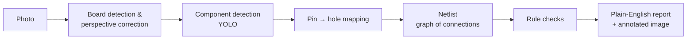

# Circuit Debugger

[](https://github.com/shysta1257/circuit-debugger/actions/workflows/ci.yml)


When a breadboard project doesn't work, it's often a wrong connection that's really hard to spot by eye.
**Circuit Debugger** takes a photo of a breadboard circuit, works out what's on the board, rebuilds the
connections, and explains in plain English what's likely wrong.

## How it works



| Stage | What it does | Tools |
|---|---|---|
| Board detection | Finds the breadboard and warps it to a top-down view | OpenCV |
| Component detection | Locates resistors, LEDs, wires, ICs, power | Ultralytics YOLO |
| Pin mapping | Assigns each component leg to a breadboard hole | OpenCV, NumPy |
| Netlist | Models which holes are electrically connected | NetworkX |
| Rule checks | Flags LEDs without resistors, shorts, reversed polarity, ... | Python |

The connection model and rule checker work on their own from a JSON description of a circuit,
so they can be developed and tested independently of the vision pipeline.

## Project structure

```
src/circuit_debugger/   # library code
tests/                  # pytest test suite
```

## Getting started

```bash
git clone https://github.com/shysta1257/circuit-debugger.git
cd circuit-debugger
python -m venv .venv && source .venv/bin/activate
pip install -e ".[dev]"
pytest
```

## Roadmap

- [x] Project setup, tests and CI
- [ ] Breadboard + component model and netlist builder
- [ ] Rule checks with explanations
- [ ] Labelled breadboard dataset
- [ ] Vision pipeline (board detection, YOLO, pin mapping)
- [ ] Evaluation: detection mAP, netlist accuracy, bug-detection rate
- [ ] Web demo

## Results

_Coming soon: detection metrics, netlist accuracy and failure analysis._
